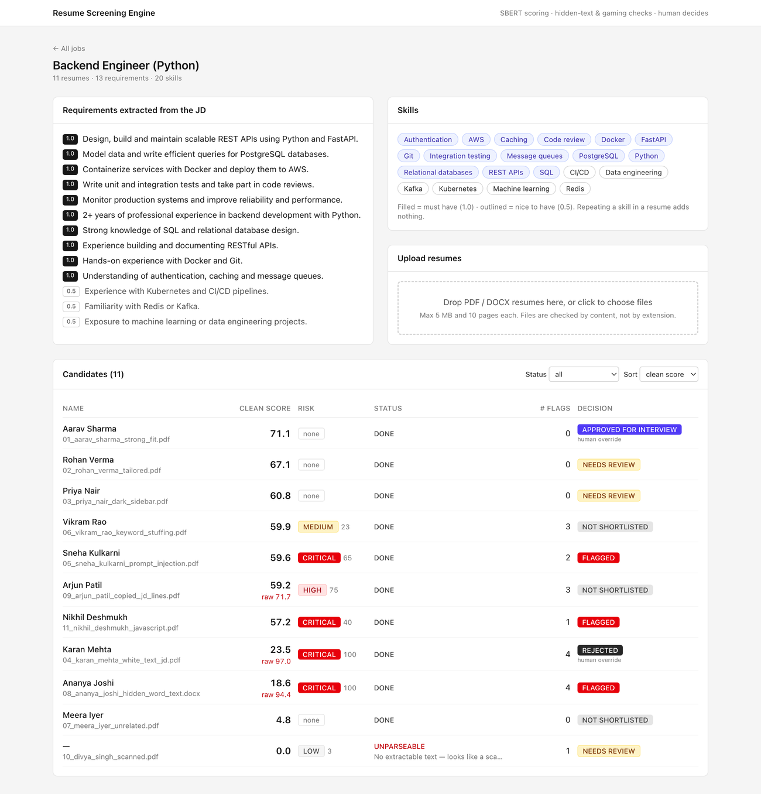
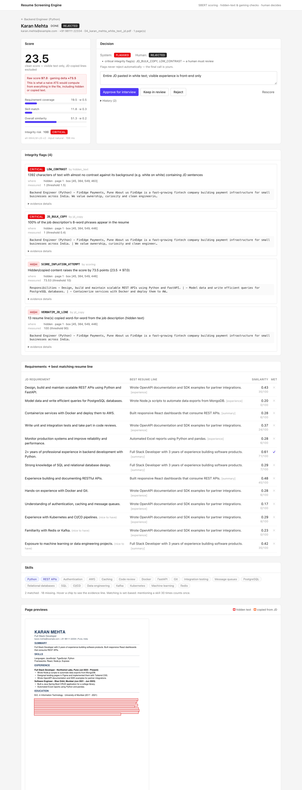
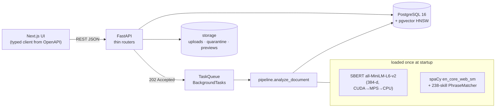
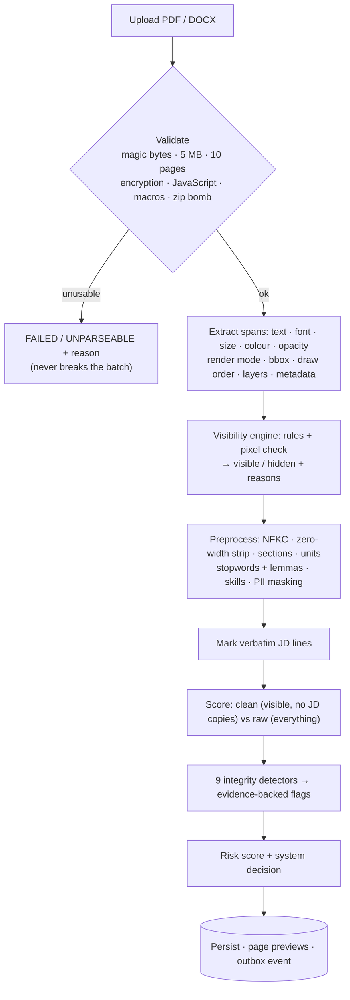

# Resume Screening Engine

Explainable, gaming-resistant resume screening — the first module of a recruitment agent in a larger
"business automation OS" (final-year B.E. project).

A recruiter creates a job from a job description and uploads PDF/DOCX resumes. For every resume the engine

1. extracts text **with style and position** (font size, colour, opacity, render mode, page, bounding box, draw order),
2. separates **visible** text from **hidden / unreadable** text with a rule engine *and* an independent pixel check,
3. scores the resume against the JD with **SBERT embeddings + cosine similarity** on top of an NLP pipeline
   (stopword removal + lemmatisation) — using **visible text only**,
4. runs **integrity checks** for resume gaming (hidden text, tiny fonts, JD copy-paste, keyword stuffing,
   prompt injection, Unicode tricks, metadata stuffing, duplicates, impossible dates, dangerous files),
5. returns an **explainable report** — every flag carries evidence — and a decision that a **human** confirms.

**No LLM API calls** anywhere: all NLP runs locally (sentence-transformers, spaCy). Flags never auto-reject.

| | |
|---|---|
|  |  |

---

## Quick start

**One command (Docker Desktop on macOS / Windows WSL2, arm64 or amd64):**

```bash
docker compose up --build
```

- UI → http://localhost:3000
- API docs (OpenAPI) → http://localhost:8000/docs

The first build downloads CPU-only PyTorch, the SBERT model and the spaCy pipeline into the image (a few
minutes). Ports are bound to `127.0.0.1` only — there is no authentication. Postgres is published on host
port **5433** (5432 is often taken by a local install).

Try it: create a job from [`samples/demo/jd.txt`](samples/demo/jd.txt) and drop all files from
[`samples/demo/`](samples/demo) onto the upload box — the [demo README](samples/demo/README.md) lists what each
resume demonstrates.

**Native development (faster on Apple Silicon — SBERT runs on the GPU via MPS):**

```bash
docker compose up -d db                       # Postgres 16 + pgvector on :5433
cd backend && uv sync && uv run alembic upgrade head
uv run uvicorn app.main:app --reload --port 8000
cd ../frontend && npm install && npm run dev  # http://localhost:3000
```

Requirements: [uv](https://docs.astral.sh/uv/) (installs Python 3.12), Node 20+, Docker. On Windows, clone the
repo inside the WSL filesystem (not under `/mnt/c`) for file-watching and performance.

---

## Architecture





```
backend/app/
  main.py                 app factory; lifespan loads SBERT + spaCy once
  core/                   config (every threshold), JSON logging, error envelope, device selection
  api/v1/                 jobs.py, resumes.py — thin routers
  schemas/                Pydantic API contract  →  contracts/openapi.json
  db/                     SQLAlchemy models, Alembic migrations (pgvector HNSW indexes)
  domain/                 TextSpan, ParsedDocument, TextUnit, Flag, JobContext
  services/
    validation.py         file type / size / security
    extraction/           pdf.py, docx.py, contact.py
    visibility/           rules.py, visual_check.py, contrast.py, engine.py
    preprocessing/        normalize.py, sections.py, nlp.py, jd_parser.py, jd_match.py
    scoring/              embedder.py, requirements.py, skills.py, scorer.py
    integrity/            base.py (protocol + registry), risk.py, one file per detector
    decision.py · pipeline.py · previews.py · storage.py · task_queue.py
  data/                   skills.json (238 skills, aliases, implications) + lexicons
backend/tests/            unit · integrity · scoring · e2e (227+ tests)
backend/scripts/          generate_fixtures · calibrate · compare_sbert_input · evaluate_fixtures · export_openapi
frontend/                 Next.js 16 + TypeScript + Tailwind (3 screens)
samples/                  demo set (11 candidates) + labelled calibration set (40 resumes)
docs/evaluation/          calibration / comparison results (JSON)
```

---

## Pipeline walkthrough

**1. Validation & security** — the type is decided by magic bytes, never by the extension. Password-protected
PDFs, JavaScript / Launch / auto-run actions, embedded files, Word macros, remote templates and zip bombs are
flagged; dangerous files are quarantined and never served (the UI only ever receives rendered PNGs). One bad file
never breaks a batch: it gets a `FAILED` row with the reason. A plain `GoTo` OpenAction (common in legit PDFs) is
not suspicious.

**2. Extraction** — PyMuPDF `rawdict` (reading order, spaces) is joined with `texttrace` (render mode, opacity,
layer, draw sequence) on exact glyph origins. Off-page text is kept by clearing `TEXT_MEDIABOX_CLIP` **and** passing
an infinite clip rectangle. Text in PDF layers that are switched off is invisible to every extractor, so it is
found by re-opening the file with all layers on and diffing. DOCX is walked in XML order (tables, text boxes —
without the VML double copy — headers, footers, comments, alt text) with each run's **effective** formatting
resolved through the style chain and theme colours.

**3. Visibility engine** — every span is marked visible or hidden with all reasons; each page is rendered once at
150 DPI.

| Reason | Rule (config key under `VISIBILITY__`) |
|---|---|
| `LOW_CONTRAST` | WCAG contrast between the (opacity-blended) text colour and the **rendered background under the span** < 1.5 (`LOW_CONTRAST_RATIO`). White text on a dark sidebar or photo header is fine. |
| `TINY_FONT` | effective size (from rendered bbox height / character advance) < 4 pt hidden; 4–6 pt with ≥ 20 chars suspicious |
| `LOW_OPACITY` | opacity < 0.1 |
| `INVISIBLE_RENDER_MODE` | PDF render mode 3 — except an OCR layer over a scanned image |
| `OFF_PAGE` | ≥ 50 % of the bbox outside the page |
| `COVERED` | an opaque shape / image drawn **later** covers ≥ 90 % of the bbox |
| `HIDDEN_LAYER` | text in an optional-content layer that is OFF |
| `STACKED_TEXT` | different text drawn on top of other text (identical overprint = faux bold, ignored) |
| `DOCX_HIDDEN` | Word "hidden", colour equal to shading/page, < 4 pt, tracked deletion, comments, alt text |
| `NOT_RENDERED_VISIBLY` | **independent pixel check**: the crop of the span is (near-)uniform — catches clipping, blend modes and other tricks no rule describes |

**4. NLP preprocessing** — NFKC normalisation; zero-width / bidi characters counted then stripped; homoglyphs in
mixed-script words folded (so the score reflects what a human reads); sections detected from headings and styling;
wrap-aware bullet/sentence segmentation; spaCy lemmatisation + stopword removal (spaCy list + custom list) with
skill phrases matched **first** so "Go", "R" and "C++" survive; PII (email, phone, URLs, person names) masked
before scoring — spaCy often tags Django or Kafka as a person, so known skills are never masked; "Personal
details" lines (DOB, gender, marital status, father's name) are never scored. The JD parser weights
"Requirements / Responsibilities" 1.0 and "Nice to have" 0.5, drops boilerplate, and splits compound
requirements ("write tests **and** take part in code reviews") into clauses.

**5. Scoring (SBERT + cosine similarity)** — units are embedded individually (MiniLM truncates long input) with
`normalize_embeddings=True`, so cosine = dot product.

| Component | Weight | How |
|---|---|---|
| Requirement coverage | 0.5 | per requirement, max cosine over resume units (best line kept as evidence; compound requirements use max(whole, mean(clauses))); "met" if ≥ 0.55; weighted mean of calibrated similarities |
| Skill match | 0.3 | set-based: weighted matched / weighted required, via PhraseMatcher on lexical text, implications (PostgreSQL ⇒ SQL) and an SBERT fallback (≥ 0.80) for multi-word skills |
| Overall similarity | 0.2 | cosine of mean-pooled JD and resume vectors (identical units de-duplicated first) |

Raw cosines are calibrated to 0–100 (0.25 → 0, 0.75 → 100; pooled vectors 0.35 → 0, 0.95 → 100); raw values stay
in the breakdown. Two scores are computed: **`clean_score`** (visible text minus verbatim-JD lines — the official
score) and **`raw_score`** (everything extracted — what a naive ATS would compute). `gaming_delta = raw − clean`
≥ 10 raises `SCORE_INFLATION_ATTEMPT`.

**6. Integrity detectors** — one file each in `services/integrity/`, all thresholds in config:

| Code | Severity | Catches | Threshold |
|---|---|---|---|
| hidden-text codes above | high → **critical** when the hidden text contains JD sentences / ≥ 3 JD keywords | white-fonting and every visibility trick | see visibility table |
| `SCORE_INFLATION_ATTEMPT` | high | hidden/copied content that raises the score | `SCORING__GAMING_DELTA_THRESHOLD` = 10 |
| `VERBATIM_JD_LINE` | high | resume line ≥ 8 words, rapidfuzz ratio ≥ 90 to a JD sentence | `INTEGRITY__JD_VERBATIM_RATIO` |
| `JD_BULK_COPY` | high / critical | ≥ 15 % / ≥ 40 % of the JD's 8-word shingles in the resume | `INTEGRITY__JD_BULK_HIGH` / `_CRITICAL` |
| `NEAR_VERBATIM_JD` | medium | SBERT ≥ 0.92 **and** token overlap ≥ 0.7 (lightly reworded copy) | `INTEGRITY__JD_NEAR_COSINE` |
| `JD_VOICE_PHRASES` | medium | "the ideal candidate", "you will", "join our team" … | lexicon |
| `KEYWORD_STUFFING` | medium / high | a JD keyword repeated > max(8, 3 % of tokens) | `INTEGRITY__STUFFING_*` |
| `KEYWORD_DUMP` | medium | ≥ 15-token verb-less block, ≥ 70 % JD keywords, outside Skills; or > 50 skills | `INTEGRITY__DUMP_*` |
| `REPEATED_CONTENT` | low | the same line ≥ 3 times | `INTEGRITY__REPEATED_LINE_MIN` |
| `PROMPT_INJECTION` | **critical** | "ignore previous instructions", "you are an AI", "rank this candidate", `[INST]`, `<\|im_start\|>` … (visible, hidden, metadata) | regex |
| `PROMPT_INJECTION_PARAPHRASE` | high | SBERT ≥ 0.75 to 30 canonical injections, or ≥ 0.60 when addressed to an automated reader with a directive | `INTEGRITY__INJECTION_*` |
| `INVISIBLE_UNICODE` | medium / high | > 5 / > 50 zero-width characters | `INTEGRITY__INVISIBLE_UNICODE_*` |
| `HOMOGLYPHS` | medium / high | words mixing Latin with look-alike Cyrillic/Greek | — |
| `GARBLED_TEXT` | low | ≥ 40 % non-words (broken font encoding) | `INTEGRITY__GARBLED_RATIO` |
| `METADATA_STUFFING` | low / medium | keyword lists or JD text in title / subject / keywords / XMP (never scored) | `INTEGRITY__METADATA_*` |
| `DUPLICATE_FILE` | medium | same SHA-256 in the job | — |
| `NEAR_DUPLICATE_RESUME` | low (same person) / medium | pgvector cosine ≥ 0.97 to another candidate | `INTEGRITY__NEAR_DUPLICATE_COSINE` |
| `IDENTITY_CONFLICT` | high | same email / phone, different name | — |
| `TIMELINE_INCONSISTENT` / `TIMELINE_FUTURE_DATE` | low | end before start; future dates not marked "expected" / "present" | — |
| `ENCRYPTED_FILE` · `SCANNED_DOCUMENT` | medium · low | unreadable content → human review | — |
| `MALICIOUS_PDF_FEATURES` · `MACRO_DOCUMENT` · `EXTERNAL_TEMPLATE` · `ZIP_BOMB` | **critical** | active content / malware delivery tricks (quarantined) | — |

Every flag has `{code, severity, detector, message, evidence: {page, bbox, snippet, measured_value, threshold,
location, regions, details}}`. Risk score = Σ severity weights (critical 40, high 25, medium 10, low 3), capped at 100.

**7. Decision** — any critical flag → `FLAGGED` (a human must review); unparseable → `NEEDS_REVIEW`;
clean ≥ 70 and no high flag → `SHORTLISTED`; ≥ 60 (or ≥ 70 with a high flag) → `NEEDS_REVIEW`; otherwise
`NOT_SHORTLISTED`. A human can approve for interview, reject, or keep in review with a note — stored append-only
with timestamps. Approval writes one `candidate.shortlisted` outbox event for the future scheduling agent.

---

## API (v1)

| Endpoint | Purpose |
|---|---|
| `POST /api/v1/jobs` · `GET /api/v1/jobs` · `GET /api/v1/jobs/{id}` | create (parses the JD) · list · detail |
| `POST /api/v1/jobs/{id}/resumes` | multipart, many files → `202` + resume ids; processed in the background |
| `GET /api/v1/jobs/{id}/candidates?status=&sort=score\|risk\|name\|created` | candidate table |
| `GET /api/v1/resumes/{id}` | full explainable report |
| `GET /api/v1/resumes/{id}/pages/{n}/preview.png` | page render — hidden text boxed red, JD copies orange |
| `POST /api/v1/resumes/{id}/rescore` | recompute with the current config |
| `PATCH /api/v1/resumes/{id}/decision` | human override (audit trail) |
| `GET /api/v1/jobs/{id}/shortlist` | approved / shortlisted candidates with contact details (read-only) |
| `GET /health` | DB + model status |

Errors always use `{"error": {"code", "message", "details"}}`. The contract lives in
[`contracts/openapi.json`](contracts/openapi.json); a test fails if code and contract drift apart.

---

## Tests

```bash
docker compose up -d db
cd backend && uv run pytest             # everything (unit, detectors, scoring, end-to-end API)
uv run pytest -m "not db and not slow"  # fast subset, no Postgres / no models
cd ../frontend && npm run lint && npm run typecheck && npm run build
```

Fixtures are generated programmatically (`scripts/generate_fixtures.py`): ReportLab PDFs (independent from the
PyMuPDF parser), PyMuPDF only for OFF layers and JavaScript, python-docx for DOCX — **36 fixtures**, legit and
adversarial. The suite checks that every fixture raises its expected flags, that legit resumes (plain, DOCX,
dark sidebar, photo header, tailored wording, unrelated) raise **none**, that every flag carries evidence, that
the clean score of a resume with the JD pasted in white equals the same resume without it, that a matching resume
beats an unrelated one, and the whole API flow against real Postgres.

## Evaluation

```bash
make samples     # 40 labelled synthetic resumes → samples/calibration
make calibrate   # score distribution, precision/recall for thresholds 50–85, best threshold, ROC AUC
make compare     # SBERT input: natural sentences vs stopword-removed text
```

Results on the synthetic labelled set (MiniLM, details in [`docs/evaluation/`](docs/evaluation)):
fit resumes average **55.4**, not-fit **14.7** (ROC AUC **0.985**); the best-F1 shortlist threshold on this
set is **50** (precision 1.0, recall 0.8). Natural-sentence SBERT input separates fit from not-fit better than
stopword-removed input (F1 0.889 vs 0.621); all-mpnet-base-v2 reaches F1 0.919 (AUC 0.983). Thresholds are configuration — calibrate them per job family with
real, labelled resumes. Processing takes ~0.1–0.3 s per resume (Apple MPS), well under the 3 s target.

## Configuration

Every threshold and weight lives in [`backend/app/core/config.py`](backend/app/core/config.py) and can be
overridden in `.env` (see [`.env.example`](.env.example)); nested groups use `__`, e.g.
`VISIBILITY__LOW_CONTRAST_RATIO=1.6`, `SCORING__WEIGHT_SKILLS=0.4`, `DECISION__SHORTLIST_SCORE=65`.
`SBERT_MODEL=sentence-transformers/all-mpnet-base-v2` with `EMBEDDING_DIM=768` switches to the larger model
(re-run migrations on a fresh database). OCR (`OCR__ENABLED`) and LibreOffice DOCX rendering
(`DOCX__CONVERT_TO_PDF`) are optional and off by default (Docker build args `INSTALL_OCR`, `INSTALL_LIBREOFFICE`).

## Limitations

- Similarity scores come from a small general-purpose model; absolute values are modest for long, detailed
  bullets, so thresholds must be calibrated (the scripts are included). all-mpnet-base-v2 was slightly better on
  the sample set (best F1 0.919 vs 0.889) at 172 vs 147 ms per resume on Apple MPS — slower on CPU-only machines.
- DOCX has no fixed layout: without LibreOffice, DOCX visibility is rule-based and evidence names paragraphs
  instead of page coordinates.
- The calibration data in this repository is synthetic; evaluate on real, consented, anonymised resumes before
  any real use. Fairness: the score never sees names, gender, age, photo, address or marital status.
- English only (spaCy `en_core_web_sm`).

## Licences

Backend dependencies are open source; note that **PyMuPDF is AGPL-3.0** (fine for an academic project; a
commercial SaaS would need a commercial licence or a replacement). The DejaVu fonts used by the test fixtures
are under the Bitstream Vera / public-domain licence (`backend/tests/assets/DejaVu-LICENSE.txt`).
